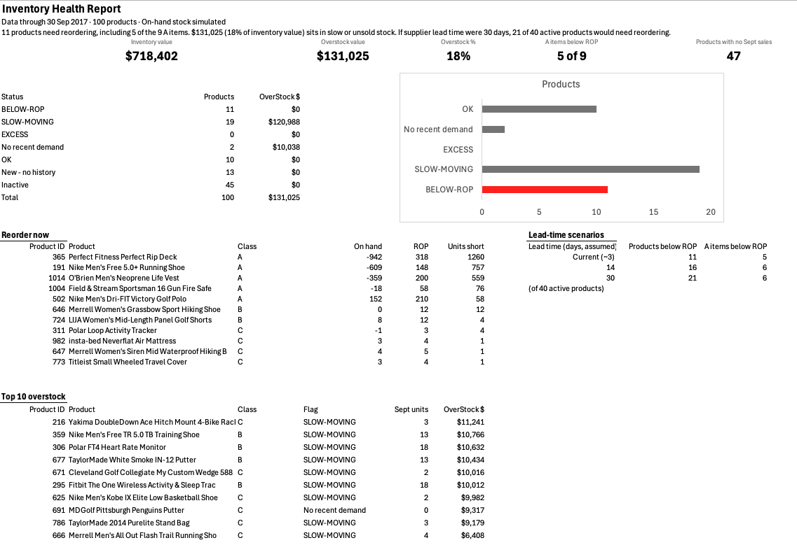
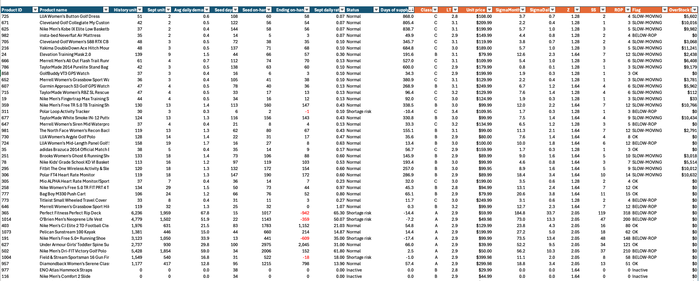
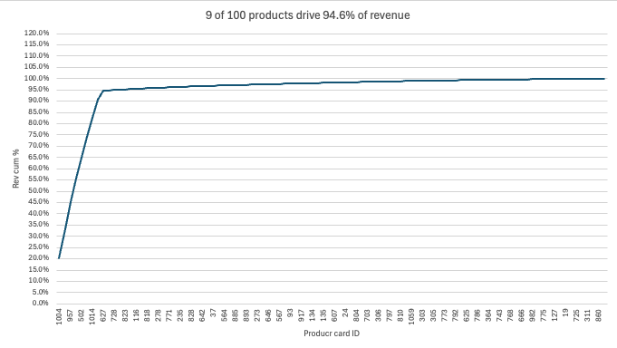

# Project 1 — Inventory Health Report (Excel)

**Business question:** Which products need reordering now, and where is cash tied up in stock that isn't selling?

## Data
DataCo Smart Supply Chain (Kaggle) — 164,572 order lines, 100 products, Jan 2015 – Sep 2017, after cleaning (180,519 raw rows). Every cleaning step and assumption is logged in the workbook's **Data Notes** tab.

## What I built
1. **Cleaned the raw file in Power Query** — removed truncated months, cancelled and suspected-fraud orders, empty and personal-data columns; documented each fix.
2. **ABC classification on revenue**, with a units ABC run alongside for comparison. The Pareto curve showed a clear break after 9 products, so the A cutoff was set there (94.6% of revenue) instead of the textbook 80%.
3. **Simulated on-hand stock** (the dataset has no inventory table) and calculated days of supply.
4. **Statistical reorder points:** safety stock = Z × demand variability × √lead time, with service levels by class (A 98%, B 95%, C 90%).
5. **One-page summary:** KPI tiles, status breakdown, reorder list, top overstock, and a lead-time sensitivity test.

## Findings *(on simulated stock levels)*
- **Demand is highly concentrated:** the same 9 of 100 products lead on both revenue (~95%) and units (88%) — and they are the only products sold in every month of the data. The two measures differ only in how they rank the low-volume tail. 47 products sold nothing in September 2017.
- **Shortage risk sits where it matters most:** 11 products are below their reorder point, including 5 of the 9 A-items (4 already out of stock).
- **Cash is stuck in the tail:** $131K — 18% of inventory value — sits in 21 slow-moving or unsold products. No high-volume product is overstocked.
- **The lead-time assumption matters:** if supplier lead time were 30 days instead of the ~3-day proxy, products needing reorder rise from 11 to 21 of 40 active products.

## Limitations
- On-hand stock is **simulated** (random 6–150 days of cover per product), so *which* products are flagged comes from the simulation; the reorder and flag logic works for any real stock input.
- Lead time is **proxied** from scheduled shipping days (delivery to customers, not supplier replenishment), so it is a lower bound.
- Overstock is valued at **selling price** — the data has no cost field.
- Almost the whole catalogue changed in April 2017; this looks like an artefact of how the dataset was generated, so I built around it rather than treating it as a business finding.

## Files
- `inventory-health-report.xlsx` — the workbook (Summary, model table, Data Notes)
